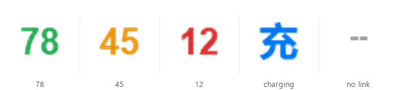

# AJ179 Battery Tray

English · [简体中文](README.md)

[](https://github.com/)
[](https://www.python.org/)
[](LICENSE)
[]()

Battery percentage in the Windows system tray for the **AJAZZ AJ179 APEX** wireless mouse,
plus **OLED clock sync for the charging dock**.
Talks to the HID device directly — no vendor driver, no network, no changes to your mouse settings.



## Features

- Tray icon shows the **battery percentage**: green (>50%) / orange (21–50%) / red (≤20%), blue while charging
- Hover for percentage and last-updated time; left click to refresh (auto every 60 s)
- One Windows notification when battery drops to ≤20%
- **Dock OLED clock**: pushes the system time to the charging dock every 30 s while running
- Optional run-at-login (`HKCU\...\Run`, no shortcut files left behind)
- Single instance; `--once` prints JSON so you can wire it into your own scripts

## Quick start

Windows + Python 3.9 or newer ([download](https://www.python.org/downloads/windows/), tick *Add Python to PATH*).

```text
1. Double-click setup.bat    # creates .venv, installs deps (once)
2. Double-click start.bat    # percentage appears in the tray
```

Or manually:

```bash
pip install -r requirements.txt
pythonw aj179_tray.py
```

> Windows may hide the icon — click `^` in the taskbar and drag it out to pin it.

## Usage

Right-click the tray icon:

| Menu | Action |
|---|---|
| Refresh now | Read once (same as left click) |
| Details | State, product name, timestamp, raw HID frame as hex |
| Dock clock | Toggle clock sync (persisted in `config.json`) |
| Sync clock now | Force one clock update |
| Run at login | Registry autostart toggle |
| Quit | Exit |

Re-toggle "Run at login" after moving the folder.

## CLI

```bash
python aj179_tray.py --once         # one-shot JSON (includes clock_synced)
python aj179_tray.py --sync-clock   # push the clock once
python aj179_tray.py --quit         # graceful exit of a running instance
python aj179_battery.py             # human-readable state + raw frame
```

## Protocol

Reverse-engineered by hand — there is no public documentation for this model. Useful if you own a similar SONiX-based AJAZZ device.

VID `0x3151`, vendor control collection `usage_page=0xFFFF, usage=0x02`.

| Form factor | PID | Product string |
|---|---|---|
| 2.4G receiver | `0x5007` | AJAZZ 2.4G 8K |
| Wired / charging | `0x4026` | AJAZZ AJ179 APEX |

### Battery: reading alone returns zeros

The receiver only brings up the 2.4G telemetry link after it receives the vendor status poll.
Without it the status page is **all zeros, always**. Every read is therefore three steps:

1. **SET_FEATURE** status poll — report id `0x00`, opcode `0xF7`, everything else zero, no payload, no checksum. This is the heartbeat the vendor driver sends once per second.
2. Wait ~50 ms.
3. **GET_FEATURE** report `0x05` — percentage in byte 3:

```text
05 00 00 38 01 00 01 02
      ^^^^^^
      0x38 = 56%
```

A frame is valid only if the bytes between the report id and the percentage are zero (garbage shows up right after reconnects).
An all-zero frame means the link is not ready — treated as *unknown*, **never reported as 0%**.

### Dock clock: `0x28 SET_OLEDCLOCK`

64-byte feature report on the same collection, **no checksum**:

```text
frame[0] = 0x00 report id     frame[1] = 0x28 command     frame[2..7] = 0
frame[8] = 0xD7 required marker
frame[9..10] = year (big endian)   frame[11] = month  frame[12] = day
frame[13] = hour  frame[14] = minute  frame[15] = second
```

Verified with `2026-11-10 18:30:00`:

```text
00 28 00 00 00 00 00 00 d7 07 ea 0b 0a 12 1e 00
```

Three non-obvious gotchas:

1. **Drop the `0xD7` marker and the firmware silently discards the packet** — no error, no ack. This is the most common reason clock sync "doesn't work".
2. **You must resend periodically.** The dock resets itself back to `00:00` within a few minutes, and the device never leaves the USB tree, so there is no hotplug event to hook. Sending every 30 s is how the feature is supposed to work, not a fallback.
3. The firmware only starts accepting the frame ~2 s after power-up; the app waits 3 s before the first send.

The command has **no acknowledgement**. A successful send only means the USB write went through — the only way to verify is to look at the dock's screen.

### Charging state

Plugging in changes the PID from `0x5007` to `0x4026` and the mouse switches to the wired channel:

- if a percentage is still readable → blue number
- otherwise → blue **充** glyph, never a made-up 0%

This part came from plug/unplug testing; the public reverse-engineering docs do not mention it.

## Compatibility

Matching is by VID `0x3151` plus the vendor interface signature, so **other AJAZZ models on the same platform (AJ159, AJ199, ...) will likely work** — only the AJ179 APEX has been tested.
Other brands do not apply at all (Logitech uses its own HID++ protocol).

If it works on your model, please open an issue with the model name and PID.

## Tests

Frame parsing is pure functions — no hardware needed:

```bash
python -m unittest discover -s tests -v
```

## Limitations

- When the mouse is deeply asleep the receiver returns nothing; the tray shows `--` and keeps the last reading until the next refresh.
- While the mouse is plugged in and charging, the dock's HID interface disappears from the system, so clock sync pauses; it resumes automatically within 30 s after unplugging (and immediately when the state flips back to wireless).
- Windows only (tray, registry autostart and the `ctypes` message box are Win32).

## Credits

Protocol details come from these public reverse-engineering efforts:

- [Aiacos/ajazz-control-center](https://github.com/Aiacos/ajazz-control-center) — AJAZZ AJ-series protocol docs
- [reicheltp/ajazz-macos-mousetime-sync](https://github.com/reicheltp/ajazz-macos-mousetime-sync) — dock clock frame layout
- [xrfc/gpw-battery-tray](https://github.com/xrfc/gpw-battery-tray) — the project that inspired this one

## License

[MIT](LICENSE)
